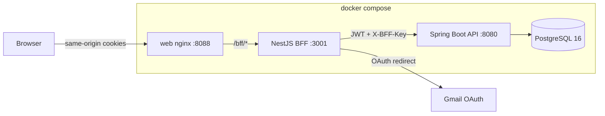

# NexusCRM

Multi-tenant CRM SaaS for teams that want a sellable workspace: contacts, companies, pipeline, activities, and a first-class mailbox (mock, Gmail OAuth, or IMAP/SMTP).

The browser talks **only** to the BFF. The Spring API never sees the user’s cookies and never enables CORS for the SPA.

## Quick start

```bash
cp .env.example .env
docker compose up --build
```

Open [http://localhost:8088](http://localhost:8088).

**Demo login**

| | |
|---|---|
| Email | `oscar.d@example.net` |
| Password | `Demo1234!` |
| Workspace | Acme Robotics (plan `PRO`) |

Seed data includes contacts, companies, five deals (including a `WON` spare-parts portal), activities, and a mock mailbox with inbox / sent / draft threads.

Local development without Docker:

```bash
# Postgres 16 on localhost:5432, db/user/pass = nexuscrm/nexus/nexus
cd apps/api && mvn spring-boot:run
cd apps/bff && npm install && npm run start:dev
cd apps/web && npm install && npm run dev   # http://localhost:5173, proxies /bff → :3001
```

## Architecture



| Layer | Stack | Responsibility |
|---|---|---|
| `apps/web` | React 18, TypeScript, Vite, TanStack Query | SPA: dashboard, contacts, companies, pipeline, activities, mail, settings |
| `apps/bff` | NestJS 10, httpOnly cookies, CSRF, login rate limit | Session boundary, `/bff/api/*` proxy, Gmail OAuth redirect |
| `apps/api` | Java 21, Spring Boot 3.4, JPA, Flyway, Actuator, OpenAPI | Domain API, tenant isolation, mailbox providers |
| Postgres 16 | Shared schema + `tenant_id` | System of record |

## Multi-tenancy

- Every business row carries `tenant_id` (UUID). Unique indexes are tenant-scoped.
- After login the access JWT includes `tenantId` and `role` (`OWNER`, `ADMIN`, `MEMBER`, `VIEWER`).
- The API sets `TenantContext` from the JWT, enables a Hibernate `tenantFilter`, **and** uses tenant-scoped repository methods (`findByTenantId…`) on list endpoints so an unfiltered query never scans another workspace.
- `GET /api/v1/deals` does **not** bind a null search string into `LOWER(title)`. Blank queries use `findByTenantIdAndDeletedAtIsNull…`. The pipeline UI shows an error banner if the list call fails instead of rendering a false-empty board.

## Environment variables

| Variable | Used by | Purpose |
|---|---|---|
| `POSTGRES_*` / `DATABASE_URL` | api | Database connection |
| `NEXUS_JWT_SECRET` | api | HMAC secret for access/refresh JWTs (≥ 32 chars) |
| `NEXUS_ENCRYPTION_KEY` | api | AES-256-GCM key for mailbox credentials (64 hex chars) |
| `NEXUS_BFF_API_KEY` | api + bff | Shared `X-BFF-Key`. API rejects requests without it |
| `NEXUS_BFF_ORIGIN` | api | CORS allow-list (BFF origin only) |
| `NEXUS_SEED` | api | Seed Acme Robotics when `true` |
| `API_BASE_URL` | bff | Upstream Spring URL |
| `WEB_ORIGIN` | bff | Cookie/CORS + OAuth return origin |
| `COOKIE_SECURE` / `COOKIE_DOMAIN` | bff | Set `true` + your domain behind HTTPS |
| `GOOGLE_CLIENT_ID` | api + bff | Gmail OAuth client |
| `GOOGLE_CLIENT_SECRET` | api + bff | Gmail OAuth secret (never sent to the browser) |
| `GOOGLE_REDIRECT_URI` | api + bff | Must match the Google console, default `http://localhost:8088/bff/oauth/gmail/callback` |

Copy `.env.example` and rotate every secret before production.

## Gmail OAuth

1. Create a Google Cloud OAuth client (web application).
2. Authorized redirect URI: `http://localhost:8088/bff/oauth/gmail/callback` (or your public HTTPS URL).
3. Set `GOOGLE_CLIENT_ID`, `GOOGLE_CLIENT_SECRET`, and `GOOGLE_REDIRECT_URI`.
4. In the product, open **Mail → Connect Gmail**. The BFF performs the redirect; the API stores encrypted refresh tokens.

Without Google credentials, use **Connect demo mailbox** — the mock `MailboxProvider` is fully demonstrable.

IMAP/SMTP mailboxes are connected via `POST /api/v1/mailboxes/imap` (host, ports, username, password). Credentials are encrypted at rest.

## API & health

- OpenAPI UI (from a trusted network / via BFF in production): [http://localhost:8080/swagger-ui.html](http://localhost:8080/swagger-ui.html)
- API health: `GET /actuator/health`
- BFF health: `GET /bff/health`
- Error shape: `{ "code": "...", "message": "...", "details": optional }`

Plan tiers `FREE` / `PRO` / `BUSINESS` exist on the tenant. `POST /api/v1/billing/checkout` is a stub (no Stripe).

## CI / CD

`.github/workflows/ci-cd.yml` runs API tests, BFF tests, and the web build on every push/PR. On `main` it publishes `api`, `bff`, and `web` images to GHCR (`ghcr.io/<owner>/nexuscrm/<app>:<sha>`) and includes a deploy job stub.

## Smoke test

1. `docker compose up --build`
2. Sign in as `oscar.d@example.net` / `Demo1234!`
3. Dashboard shows pipeline value and the five seeded deals
4. Pipeline board lists LEAD → WON (not empty)
5. Mail → mock mailbox → open an inbox thread → compose/send a mock message
6. Settings → invite a teammate / switch plan stub
